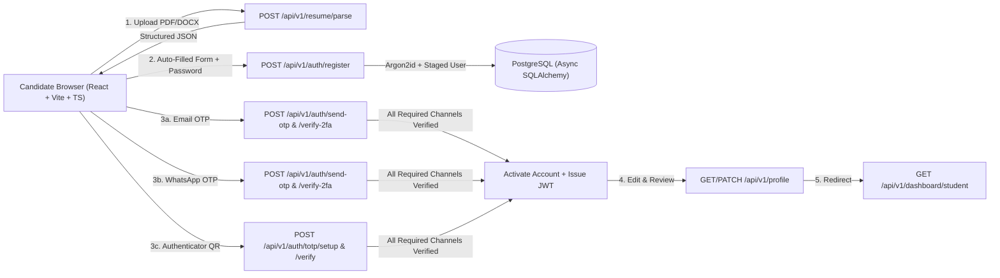

# SkillVerse EdTech — AI-Powered Resume Parser & Multi-Channel 2FA Onboarding Pipeline

## 1. Overview
**SkillVerse EdTech** is a full-stack candidate onboarding and identity verification platform built with **FastAPI (Python 3.11+)**, **SQLAlchemy 2.x Async (PostgreSQL / asyncpg)**, and **React + Vite + TypeScript + Tailwind CSS**.

The platform streamlines EdTech student registration by extracting structured candidate attributes from uploaded **PDF** and **DOCX** resumes, auto-filling the registration form, creating a staged Argon2id-protected account, enforcing **Multi-Channel Two-Factor Authentication (Email OTP, WhatsApp Business Cloud API OTP, and Browser TOTP Authenticator)**, and granting JWT-authenticated access to a personalized **Student Dashboard**.

---

## 2. Problem Statement
Traditional student and candidate onboarding portals suffer from two critical flaws:
1. **High Drop-Off During Manual Entry**: Candidates must manually type out information already present on their resumes (name, contact details, technical skills, academic qualifications, and work experience).
2. **Weak Single-Channel Verification**: Relying on basic password-only or single-channel verification leaves EdTech platforms vulnerable to fake registrations, credential stuffing, and unverified contact channels.

---

## 3. Objectives
- Automatically parse `.pdf` and `.docx` resumes into structured JSON without fabricating missing fields.
- Auto-populate candidate registration forms while allowing full candidate review and editing.
- Hash passwords using **Argon2id** (`pwdlib`) and store accounts in an initial **staged (`is_active = false`)** state.
- Require independent verification across **Email OTP (SMTP)**, **WhatsApp OTP (Meta Cloud API Adapter)**, and **Browser TOTP (RFC 6238 Authenticator App with Fernet-encrypted secrets at rest)**.
- Activate the candidate account and issue a signed **PyJWT** token (via `HttpOnly` cookie + Bearer token) only when all configured 2FA channels are verified.
- Provide a protected **Profile Preview & Editor** and **Student Dashboard**.

---

## 4. Key Features
- **Resume Parsing Engine (`POST /api/v1/resume/parse`)**:
  - Uses `pdfplumber` for PDFs and `python-docx` for DOCX files.
  - Validates file extensions, file size limits, and file magic bytes (`%PDF`, `PK\x03\x04`).
  - Detects scanned image-only PDFs that require OCR.
  - Prevents path traversal and stores uploads using UUID server-side filenames.
  - Designed around a replaceable `BaseResumeExtractor` interface so an LLM/AI extractor can be swapped in seamlessly.
- **Argon2id Staged Registration (`POST /api/v1/auth/register`)**:
  - Validates email format, 10–15 digit phone numbers, and password strength.
  - Detects duplicate email and phone accounts (`409 Conflict`).
  - Associates uploaded resume records (`user_resumes`) with the newly registered user.
- **Multi-Channel 2FA Engine**:
  - **Email OTP**: Cryptographically random 6-digit OTP (`secrets.randbelow`), HMAC-SHA256 hashed at rest, 5-minute expiration, 30-second resend cooldown, 5-attempt cap, single-use enforcement.
  - **WhatsApp OTP**: Configurable `WhatsAppProviderAdapter` supporting live **Meta WhatsApp Business Cloud API** and an explicit **Development Mock Adapter**.
  - **Browser TOTP**: Generates per-user base32 secrets encrypted at rest with **Fernet (AES-128-CBC + HMAC)**, QR code data URLs, provisioning URIs, clock-drift window (`valid_window=1`), and TOTP replay prevention.
- **JWT Session & Profile Management**:
  - Issues signed `HS256` JWTs with `jti` revocation support on logout (`POST /api/v1/auth/logout`) and `HttpOnly` cookie transport.
  - Protects `/api/v1/profile` and `/api/v1/dashboard/student` from unauthenticated (`401`) and unverified/inactive (`403`) users.

---

## 5. System Architecture



---

## 6. Technology Stack
| Layer | Technologies |
| :--- | :--- |
| **Backend** | Python 3.11+, FastAPI, Uvicorn, SQLAlchemy 2.x Async, PostgreSQL, `asyncpg`, Pydantic v2, Alembic |
| **Security** | `pwdlib` (Argon2id), `PyJWT`, `pyotp`, `cryptography` (Fernet TOTP encryption), HMAC-SHA256 OTP hashing |
| **Resume Parsing** | `pdfplumber`, `python-docx`, Regex & Section Heuristics |
| **Frontend** | React 18, Vite, TypeScript, Tailwind CSS, Axios, React Router v6, React Hook Form, Lucide React |
| **Testing** | Pytest, `pytest-asyncio`, HTTPX (`ASGITransport`), `reportlab` |

---

## 7. Project Structure
```text
ai-resume-parser-2fa-onboarding/
├── .env.example
├── .gitignore
├── README.md
├── VERIFICATION_REPORT.md
├── backend/
│   ├── alembic.ini
│   ├── requirements.txt
│   ├── app/
│   │   ├── __init__.py
│   │   ├── main.py
│   │   ├── core/
│   │   │   ├── __init__.py
│   │   │   ├── config.py
│   │   │   ├── database.py
│   │   │   ├── logging.py
│   │   │   └── security.py
│   │   ├── dependencies/
│   │   │   ├── __init__.py
│   │   │   └── authentication.py
│   │   ├── models/
│   │   │   ├── __init__.py
│   │   │   ├── user.py
│   │   │   ├── user_resume.py
│   │   │   └── otp_challenge.py
│   │   ├── routers/
│   │   │   ├── __init__.py
│   │   │   ├── resume.py
│   │   │   ├── auth.py
│   │   │   ├── profile.py
│   │   │   └── dashboard.py
│   │   ├── schemas/
│   │   │   ├── __init__.py
│   │   │   ├── resume.py
│   │   │   ├── user.py
│   │   │   ├── auth.py
│   │   │   └── profile.py
│   │   ├── services/
│   │   │   ├── __init__.py
│   │   │   ├── resume_parser.py
│   │   │   ├── registration_service.py
│   │   │   ├── otp_service.py
│   │   │   ├── email_service.py
│   │   │   ├── whatsapp_service.py
│   │   │   ├── totp_service.py
│   │   │   ├── token_service.py
│   │   │   └── profile_service.py
│   │   └── utils/
│   │       ├── __init__.py
│   │       └── file_validation.py
│   ├── migrations/
│   │   ├── env.py
│   │   ├── script.py.mako
│   │   └── versions/
│   │       └── 0001_initial_schema.py
│   ├── scripts/
│   │   └── verify_postgres.py
│   └── tests/
│       ├── __init__.py
│       ├── conftest.py
│       ├── test_comprehensive_verification.py
│       ├── test_onboarding_pipeline.py
│       └── test_postgres_integration.py
└── frontend/
    ├── index.html
    ├── package.json
    ├── package-lock.json
    ├── postcss.config.js
    ├── tailwind.config.js
    ├── tsconfig.json
    ├── tsconfig.node.json
    ├── vite.config.ts
    └── src/
        ├── App.tsx
        ├── main.tsx
        ├── index.css
        ├── vite-env.d.ts
        ├── components/
        │   ├── ProtectedRoute.tsx
        │   └── StepProgress.tsx
        ├── context/
        │   └── OnboardingContext.tsx
        ├── hooks/
        │   └── useCountdown.ts
        ├── layouts/
        │   └── MainLayout.tsx
        ├── pages/
        │   ├── LandingPage.tsx
        │   ├── ResumeUploadPage.tsx
        │   ├── RegistrationPage.tsx
        │   ├── MultiChannel2FAPage.tsx
        │   ├── ProfilePreviewPage.tsx
        │   ├── StudentDashboardPage.tsx
        │   └── LoginPage.tsx
        ├── services/
        │   └── api.ts
        └── types/
            └── onboarding.ts
```

---

## 8. Database Design
The PostgreSQL schema consists of three core tables managed via SQLAlchemy 2.x Async and Alembic:
1. **`users`**:
   - `id` (UUID PK), `full_name`, `email` (Unique + Indexed), `phone` (Unique + Indexed), `hashed_password` (Argon2id)
   - `skills` (`JSONB`), `experience` (`TEXT`), `qualification` (`VARCHAR`)
   - `totp_secret_encrypted` (`VARCHAR`, Fernet-encrypted base32 secret)
   - `is_active`, `is_email_verified`, `is_whatsapp_verified`, `is_totp_enabled` (`BOOLEAN` flags)
   - `created_at`, `updated_at` (`TIMESTAMPTZ`)
2. **`user_resumes`**:
   - `id` (UUID PK), `user_id` (FK -> `users.id`, indexed), `original_filename`, `stored_filename`, `extracted_text`, `extracted_metadata` (`JSONB`), `created_at`
3. **`otp_challenges`**:
   - `id` (UUID PK), `user_id` (FK -> `users.id`), `channel` (`email` | `whatsapp` | `totp`), `otp_hash` (HMAC-SHA256), `expires_at`, `attempts`, `verified`, `created_at`

---

## 9. Installation & Local Execution

### Step 1: Clone & Configure Environment Variables
Copy `.env.example` to `.env` in the project root and set your PostgreSQL credentials in `DATABASE_URL` (format: `postgresql+asyncpg://postgres:<YOUR_PASSWORD>@localhost:5432/edtech_onboarding`):
```powershell
Copy-Item .env.example .env
```
By default, `.env.example` configures `EMAIL_PROVIDER_MODE=mock` and `WHATSAPP_PROVIDER_MODE=mock` for safe local development (`is_simulated=true`, `delivered=false`). To enable live external delivery:
- **Live SMTP Email (`EMAIL_PROVIDER_MODE=smtp`)**: Set `SMTP_HOST`, `SMTP_PORT`, `SMTP_USERNAME`, `SMTP_PASSWORD`, and `EMAIL_FROM` in `.env`.
- **Live Meta WhatsApp Cloud API (`WHATSAPP_PROVIDER_MODE=cloud`)**: Set `WHATSAPP_ACCESS_TOKEN`, `WHATSAPP_PHONE_NUMBER_ID`, and `WHATSAPP_API_VERSION` in `.env`.

### Step 2: Backend Setup, PostgreSQL Verification & Migrations
Ensure PostgreSQL (3.11+ compatible, e.g., PostgreSQL 18) is running locally on `localhost:5432`:
```powershell
cd backend
python -m venv .venv
.\.venv\Scripts\Activate.ps1
pip install -r requirements.txt

# Verify PostgreSQL connection, create edtech_onboarding database if needed, and run Alembic migrations
python scripts/verify_postgres.py

# Or run Alembic migrations directly
alembic upgrade head

# Start FastAPI server
uvicorn app.main:app --reload --host 0.0.0.0 --port 8000
```
- **API Base URL**: `http://localhost:8000/api/v1`
- **Swagger UI Documentation**: `http://localhost:8000/docs`
- **ReDoc Documentation**: `http://localhost:8000/redoc`

### Step 3: Frontend Setup & Startup
Open a new terminal:
```powershell
cd frontend
npm install
npm run dev
```
- **Frontend URL**: `http://localhost:5173`

### Step 4: Run Automated Tests (28 Backend & PostgreSQL Integration Tests)
From the project root:
```powershell
.\backend\.venv\Scripts\pytest.exe backend/tests -v
```

---

## 10. API Reference (`/api/v1`)
| Method | Endpoint | Description | Auth Required |
| :--- | :--- | :--- | :--- |
| `GET` | `/health` | System & database health check | No |
| `POST` | `/api/v1/resume/parse` | Upload & extract structured JSON from `.pdf` or `.docx` resume | No |
| `POST` | `/api/v1/auth/register` | Register staged inactive candidate account with Argon2id | No |
| `POST` | `/api/v1/auth/send-otp` | Generate & send 6-digit OTP via `email` or `whatsapp` | No |
| `POST` | `/api/v1/auth/verify-2fa` | Verify 6-digit OTP for `email` or `whatsapp` channel | No |
| `POST` | `/api/v1/auth/totp/setup` | Provision Browser TOTP secret & QR code data URI | No |
| `POST` | `/api/v1/auth/totp/verify` | Verify 6-digit Authenticator code & activate account when policy met | No |
| `POST` | `/api/v1/auth/login` | Authenticate candidate with email & password | No |
| `POST` | `/api/v1/auth/logout` | Revoke current JWT `jti` and clear `HttpOnly` cookie | Yes |
| `GET` | `/api/v1/profile` | Retrieve authenticated & verified candidate profile | Yes (Active) |
| `PATCH` | `/api/v1/profile` | Update editable candidate profile attributes | Yes (Active) |
| `GET` | `/api/v1/dashboard/student` | Retrieve student dashboard metrics & verification summary | Yes (Active) |

---

## 11. Security Considerations
- **Zero Plaintext Storage**: Passwords use Argon2id (`pwdlib`), OTPs use salted HMAC-SHA256 hashes, and TOTP secrets use Fernet AES-128-CBC + HMAC encryption at rest.
- **Strict Input & File Validation**: Upload size limits, magic-byte inspection, filename sanitization, and Pydantic `extra="forbid"` schemas prevent mass-assignment or path traversal attacks.
- **Replay & Brute-Force Protection**: OTP challenges enforce expiration windows, resend cooldowns, maximum attempt lockouts, and single-use flags.

---

## 12. Future Enhancements
- Plug in an LLM/Vision OCR pipeline implementing `BaseResumeExtractor` for scanned image PDFs.
- Add WebAuthn / Passkey support as an optional fourth verification factor.
- Add downloadable verified student ID cards and course recommendation matching based on extracted resume skills.
